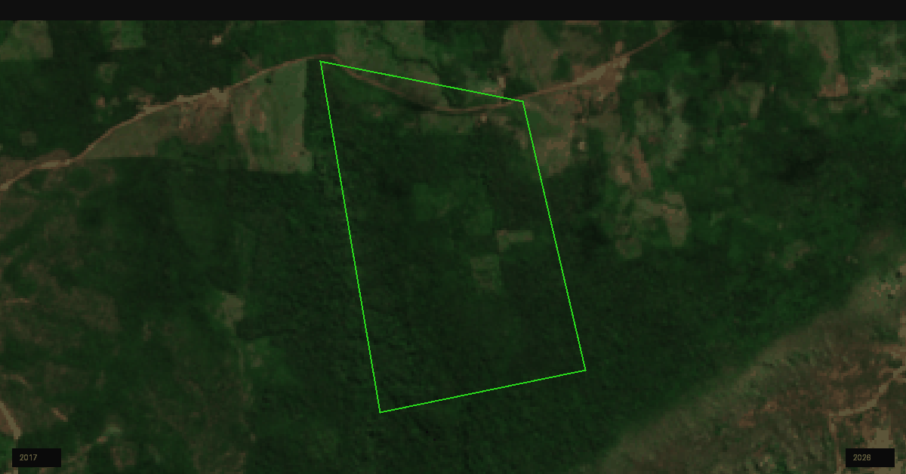

# Sentinel Time Viewer

Este repositório contém um notebook interativo para comparação temporal de imagens Sentinel-2, com controle deslizante e sobreposição de elementos vetoriais. A solução foi desenvolvida utilizando Google Earth Engine e geemap, com foco em análise visual de mudanças de cobertura e uso do solo ao longo do tempo.

## Objetivo

O projeto permite visualizar imagens de satélite em diferentes períodos e comparar áreas de interesse com maior facilidade. A interface facilita a identificação de mudanças temporais, especialmente em contextos de mapeamento ambiental e geoprocessamento.

## Funcionalidades

• Upload de shapefile compactado em formato .zip diretamente no ambiente do Google Colab  
• Filtragem automática de imagens Sentinel-2 com menos de 10% de nuvens  
• Seleção de imagens por ano  
• Comparação interativa entre períodos por meio de controle deslizante  
• Exibição do contorno do polígono sobre as camadas de imagem  

## Dados utilizados

A aplicação utiliza imagens do produto Sentinel-2 Surface Reflectance, coleção COPERNICUS/S2_SR.

Bandas principais:
• B4: vermelho  
• B3: verde  
• B2: azul  

## Requisitos

• Conta ativa no Google Earth Engine  
• Acesso ao Google Colab  
• Bibliotecas Python:
  • earthengine-api
  • geemap
  • ipywidgets  

## Como executar

1. Acesse o notebook disponível neste repositório e execute o arquivo no Google Colab.
2. Faça o upload do shapefile em formato .zip.
3. O mapa será centralizado automaticamente e a ferramenta de comparação será iniciada.
4. Selecione os anos desejados para a análise.
5. O contorno do polígono será exibido sobre as imagens, permitindo a comparação visual entre os períodos.

## Notebook

O arquivo principal do projeto é:
• GEE_swipe.ipynb

## Possíveis extensões

• Inclusão de sensores Landsat, como LC08 e LC09  
• Cálculo de índices espectrais, como NDVI e NBR  
• Exportação de imagens processadas  
• Comparação por semestre ou por estação do ano  

## Exemplo

## Autor

Samuel da Costa dos Santos

Geoprocessamento | Regularização Ambiental | Google Earth Engine e Python
